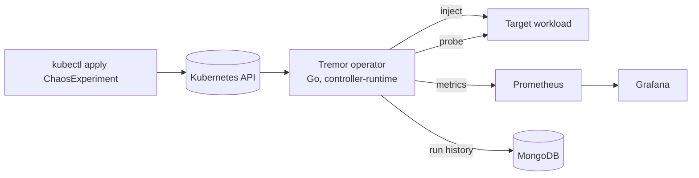

# Tremor

A chaos testing platform for Kubernetes. Declare a failure as a `ChaosExperiment`, let the Go operator inject it into your application, and get a measured **recovery time** back, with Prometheus metrics, a Grafana dashboard and a MongoDB run history.

> Status: **Phase 3 (observability)**: `PodKill` experiments report pod recovery and user-visible recovery, with Prometheus metrics and a Grafana dashboard. See [docs/ROADMAP.md](docs/ROADMAP.md).

## What it does

1. You apply a `ChaosExperiment` naming a target workload and a fault.
2. Tremor checks the application is healthy (the *steady state*).
3. It injects the fault (pod kill, network latency or loss, CPU or memory stress, dependency outage, node drain).
4. It watches the application recover and records the time to recovery.
5. Results land in the resource status, in Prometheus, and in MongoDB.



## Stack

Go operator, Kubernetes, Prometheus, Grafana, MongoDB, Docker.

## Quickstart

Requirements: Go 1.23+, Docker, [kind](https://kind.sigs.k8s.io/), kubectl, make.

```bash
make kind-up-lite      # local cluster (kind-up for 3 nodes)
make kind-deploy       # build image, load into kind, install CRD + operator
make demo-deploy       # build the demo shop, deploy it with MongoDB (3 shop replicas)
kubectl apply -f config/samples/shop-pod-kill.yaml
kubectl -n demo get chaosexperiments -w
```

When the experiment reaches `Completed`:

```bash
kubectl -n demo get chaosexperiment kill-shop -o yaml   # see status
```

| Status field | Meaning |
| --- | --- |
| `podRecoveryMillis` | Injection until every pod was Ready again |
| `userRecoveryMillis` | Injection until the HTTP steady-state probe was stable again; `0` if users never saw a failure |
| `userImpacted` | Whether any probe failed after injection |
| `probeSuccesses` / `probeFailures` | Probe counts from injection to recovery (availability = successes / total) |

Pod recovery and user recovery are often very different: with three replicas behind a Service, killing one pod may cause no visible errors at all, or a brief burst while the Service drops the dead endpoint. Tremor measures both.

Other samples: `pod-kill-dry-run.yaml` shows which pod would be chosen without killing anything; `pod-kill.yaml` plus `victim.yaml` run without a steady state (pod recovery only). Stop a running experiment with `kubectl -n demo annotate chaosexperiment kill-shop tremor.dev/abort=true`.

Safety defaults: at most 50% of pods, and at least one pod is always spared. A single-replica target is refused unless `safety.allowTotalOutage: true`.

### Dashboards (Prometheus and Grafana)

Needs [Helm](https://helm.sh/) (`winget install Helm.Helm`). About 1 GB of extra memory on the kind cluster.

```bash
make monitoring-up      # kube-prometheus-stack: Prometheus + Grafana (several minutes the first time)
make monitoring-apply   # Tremor ServiceMonitor + Grafana dashboard
make grafana            # http://localhost:3000   user: admin  password: tremor
```

Open the **Tremor chaos experiments** dashboard, then run `kubectl apply -f config/samples/shop-pod-kill.yaml` (delete the old `kill-shop` experiment first to rerun). You can watch the steady-state line drop to 0 and recover while the experiment runs. Without Helm, `kubectl -n tremor-system port-forward deploy/tremor-manager 8080:8080` and open `http://localhost:8080/metrics` to see the raw metrics.

| Metric | Type | Meaning |
| --- | --- | --- |
| `tremor_experiments_total{type,result}` | counter | Finished experiments (`completed`, `failed`, `aborted`, `dry_run`) |
| `tremor_faults_injected_total{type}` | counter | Faults injected |
| `tremor_recovery_seconds{type,kind}` | histogram | Recovery time; `kind` is `pod` or `user` |
| `tremor_experiment_phase{namespace,experiment,phase}` | gauge | 1 for the current phase |
| `tremor_steady_state_ok{namespace,experiment}` | gauge | Latest probe result while running |
| `tremor_last_recovery_seconds{namespace,experiment,type,kind}` | gauge | Last completed run |
| `tremor_last_availability_ratio{namespace,experiment}` | gauge | Passing probes / all probes in the last run |

The metrics endpoint is unauthenticated plain HTTP inside the cluster, which is fine for a local demo; production setups should front it with network policy or TLS.

### Demo shop

`cmd/shop` is a small Go orders API backed by MongoDB (`GET /healthz`, `GET /readyz`, `POST /orders`, `GET /orders`). Readiness depends on the database, so a MongoDB outage takes shop pods out of the Service, which the dependency-outage experiment in Phase 5 will exploit.

## Develop

Requirements: Go 1.23+, Docker, [kind](https://kind.sigs.k8s.io/), kubectl.

```bash
make test-unit       # unit tests only (envtest tests skip)
make test            # unit + envtest controller tests (Linux/macOS/WSL2)
make build           # builds ./bin/manager
make manifests generate   # regenerate CRD, RBAC, deepcopy after editing api/
```

## Docs

- [Design](docs/DESIGN.md)
- [Roadmap and phases](docs/ROADMAP.md)
- [Architecture decisions](docs/adr/)
- [API preview examples](examples/)

## License

MIT
