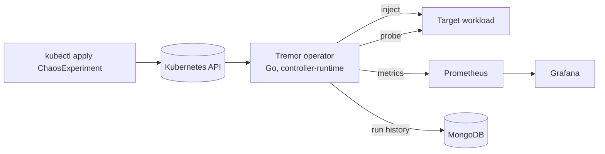

# Tremor

A chaos testing platform for Kubernetes. Declare a failure as a `ChaosExperiment`, let the Go operator inject it into your application, and get a measured **recovery time** back, with Prometheus metrics, a Grafana dashboard and a MongoDB run history.

> Status: **Phase 1 (operator core)**: `PodKill` experiments run end to end with pod-level recovery time. See [docs/ROADMAP.md](docs/ROADMAP.md).

## What it does

1. You apply a `ChaosExperiment` naming a target workload and a fault.
2. Tremor checks the application is healthy (the *steady state*).
3. It injects the fault (pod kill, network latency or loss, CPU or memory stress, dependency outage, node drain).
4. It watches the application recover and records the time to recovery.
5. Results land in the resource status, in Prometheus, and in MongoDB.



## Stack

Go operator, Kubernetes, Prometheus, Grafana, MongoDB, Docker.

## Quickstart (Phase 1)

Requirements: Go 1.23+, Docker, [kind](https://kind.sigs.k8s.io/), kubectl, make.

```bash
make kind-up-lite      # local cluster (kind-up for 3 nodes)
make kind-deploy       # build image, load into kind, install CRD + operator
kubectl apply -f config/samples/victim.yaml       # 3-replica nginx to disturb
kubectl apply -f config/samples/pod-kill.yaml     # kill one pod
kubectl -n demo get chaosexperiments -w           # watch Phase and Recovery(ms)
```

Try `config/samples/pod-kill-dry-run.yaml` to see which pod would be chosen without killing anything.
To stop a running experiment: `kubectl -n demo annotate chaosexperiment kill-victim tremor.dev/abort=true`.

Safety defaults: at most 50% of pods, and at least one pod is always spared. A single-replica target is refused unless `safety.allowTotalOutage: true`.

## Develop

Requirements: Go 1.23+, Docker, [kind](https://kind.sigs.k8s.io/), kubectl.

```bash
make test-unit       # unit tests only (envtest tests skip)
make test            # unit + envtest controller tests (Linux/macOS/WSL2)
make build           # builds ./bin/manager
make manifests generate   # regenerate CRD, RBAC, deepcopy after editing api/
```

## Docs

- [Design](docs/DESIGN.md)
- [Roadmap and phases](docs/ROADMAP.md)
- [Architecture decisions](docs/adr/)
- [API preview examples](examples/)

## License

MIT
