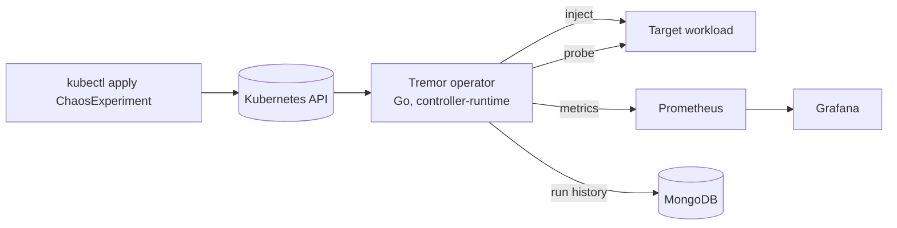

# Tremor

A chaos testing platform for Kubernetes. Declare a failure as a `ChaosExperiment`, let the Go operator inject it into your application, and get a measured **recovery time** back, with Prometheus metrics, a Grafana dashboard and a MongoDB run history.

> Status: **Phase 7 (safety and scheduling)**: seven faults (`PodKill`, `DependencyOutage`, `CPUStress`, `MemoryStress`, `NetworkLatency`, `NetworkLoss`, `NodeDrain`) report pod recovery and user-visible recovery, with namespace and probe-URL allowlists, overlap blocking, cron `ChaosSchedule`s, Prometheus metrics, a Grafana dashboard, MongoDB run history and the `tremorctl` CLI. A Helm chart and the free deployment guide come next. See [docs/ROADMAP.md](docs/ROADMAP.md).

## What it does

1. You apply a `ChaosExperiment` naming a target workload and a fault.
2. Tremor checks the application is healthy (the *steady state*).
3. It injects the fault (pod kill, network latency or loss, CPU or memory stress, dependency outage, node drain).
4. It watches the application recover and records the time to recovery.
5. Results land in the resource status, in Prometheus, and in MongoDB.



## Stack

Go operator, Kubernetes, Prometheus, Grafana, MongoDB, Docker.

## Quickstart

Requirements: Go 1.23+, Docker, [kind](https://kind.sigs.k8s.io/), kubectl, make.

```bash
make kind-up-lite      # local cluster (kind-up for 3 nodes)
make kind-deploy       # build image, load into kind, install CRD + operator
make demo-deploy       # build the demo shop, deploy it with MongoDB (3 shop replicas)
kubectl apply -f config/samples/shop-pod-kill.yaml
kubectl -n demo get chaosexperiments -w
```

When the experiment reaches `Completed`:

```bash
kubectl -n demo get chaosexperiment kill-shop -o yaml   # see status
```

| Status field | Meaning |
| --- | --- |
| `podRecoveryMillis` | Injection until every pod was Ready again |
| `userRecoveryMillis` | Injection until the HTTP steady-state probe was stable again; `0` if users never saw a failure |
| `userImpacted` | Whether any probe failed after injection |
| `probeSuccesses` / `probeFailures` | Probe counts from injection to recovery (availability = successes / total) |

Pod recovery and user recovery are often very different: with three replicas behind a Service, killing one pod may cause no visible errors at all, or a brief burst while the Service drops the dead endpoint. Tremor measures both.

Other samples: `pod-kill-dry-run.yaml` shows which pod would be chosen without killing anything; `pod-kill.yaml` plus `victim.yaml` run without a steady state (pod recovery only). Stop a running experiment with `kubectl -n demo annotate chaosexperiment kill-shop tremor.dev/abort=true`.

Safety defaults: at most 50% of pods, and at least one pod is always spared. A single-replica target is refused unless `safety.allowTotalOutage: true`.

### Dashboards (Prometheus and Grafana)

Needs [Helm](https://helm.sh/) (`winget install Helm.Helm`). About 1 GB of extra memory on the kind cluster.

```bash
make monitoring-up      # kube-prometheus-stack: Prometheus + Grafana (several minutes the first time)
make monitoring-apply   # Tremor ServiceMonitor + Grafana dashboard
make grafana            # http://localhost:3000   user: admin  password: tremor
```

Open the **Tremor chaos experiments** dashboard, then run `kubectl apply -f config/samples/shop-pod-kill.yaml` (delete the old `kill-shop` experiment first to rerun). You can watch the steady-state line drop to 0 and recover while the experiment runs. Without Helm, `kubectl -n tremor-system port-forward deploy/tremor-manager 8080:8080` and open `http://localhost:8080/metrics` to see the raw metrics.

| Metric | Type | Meaning |
| --- | --- | --- |
| `tremor_experiments_total{type,result}` | counter | Finished experiments (`completed`, `failed`, `aborted`, `dry_run`) |
| `tremor_faults_injected_total{type}` | counter | Faults injected |
| `tremor_recovery_seconds{type,kind}` | histogram | Recovery time; `kind` is `pod` or `user` |
| `tremor_experiment_phase{namespace,experiment,phase}` | gauge | 1 for the current phase (`Holding` while a sustained fault is active) |
| `tremor_steady_state_ok{namespace,experiment}` | gauge | Latest probe result while running |
| `tremor_last_recovery_seconds{namespace,experiment,type,kind}` | gauge | Last completed run |
| `tremor_last_availability_ratio{namespace,experiment}` | gauge | Passing probes / all probes in the last run |

The metrics endpoint is unauthenticated plain HTTP inside the cluster, which is fine for a local demo; production setups should front it with network policy or TLS.

### Faults

| Fault | What it does | Parameters | Recovery clock starts at |
| --- | --- | --- | --- |
| `PodKill` | Force-deletes pods | `count` | injection |
| `DependencyOutage` | Scales the Deployment or StatefulSet that owns the target pods to zero, then restores it | `duration` (needs `safety.allowTotalOutage: true`) | release |
| `CPUStress` | Burns CPU inside target pods | `count`, `cpuWorkers`, `duration` | release |
| `MemoryStress` | Holds memory inside target pods | `count`, `memoryMiB`, `duration` | release |
| `NetworkLatency` | Delays the traffic leaving target pods (tc netem) | `count`, `latency`, `jitter`, `duration` | release |
| `NetworkLoss` | Drops a share of the traffic leaving target pods (tc netem) | `count`, `lossPercent`, `duration` | release |
| `NodeDrain` | Cordons the node running the most target pods and evicts them, uncordons when the run ends | none (picks the node itself) | injection |

`duration` defaults to 30s (1s to 10m). Faults with a duration pass through a `Holding` phase; recovery times are measured from the moment the fault is released, so a 45-second outage does not count as 45 seconds of recovery. Availability still covers the whole run.

```bash
kubectl apply -f config/samples/mongo-outage.yaml       # MongoDB down for 30s, watch the shop go unready
kubectl apply -f config/samples/shop-cpu-stress.yaml    # two busy loops inside one shop pod
kubectl apply -f config/samples/shop-memory-stress.yaml # 64 MiB held inside one shop pod
kubectl apply -f config/samples/shop-network-latency.yaml # 1.5 s added to one shop pod's traffic (needs make netem-load)
kubectl apply -f config/samples/shop-packet-loss.yaml   # 60% of one shop pod's packets dropped (needs make netem-load)
kubectl apply -f config/samples/shop-node-drain.yaml    # drain a worker (needs make kind-up with two workers)
kubectl -n demo get cx -w
```

Things to know before you run them on something you care about (details in [ADR 0010](docs/adr/0010-sustained-faults.md)):

- The outage is real: with the demo's `emptyDir` MongoDB the data is gone afterwards. Tremor always restores the replica count, also when you abort or delete the experiment.
- Recovery after a sustained fault is timed from the moment the fault really ended: for stress and network faults that is the finish time of the container, not the moment the operator noticed it.
- Stress runs in an ephemeral container (Kubernetes 1.25+). It cannot be stopped early: aborting an experiment ends the experiment, but the stress process runs until its duration is up. Memory stress above the pod's memory limit causes an OOM kill, so pick the size on purpose.
- The stress image (`busybox:1.36` by default, `--stress-image` to change) must be pullable by the nodes; `make kind-deploy` preloads it into kind.
- An autoscaler or GitOps tool that scales the dependency back up during an outage ends it early. Pause them for the target.
- Network faults add a `tc netem` rule to the pod's own interface from an ephemeral container with the `NET_ADMIN` capability, so the namespace must allow that (not the `restricted` Pod Security level) and the node kernel needs the `sch_netem` module. They shape what the pod *sends*, so callers see slow or lost responses. They use their own small image (`tremor-netem:dev`, `--netem-image` to change, `make netem-load` for kind). Unlike stress, an early end works: abort or delete removes the rule within a second.
- A node drain needs somewhere for the pods to go: use the two-worker kind cluster (`make kind-up`). Tremor refuses to drain a node if that would take every replica down or exceed `maxAffectedPercent`, and an eviction that a PodDisruptionBudget refuses fails the run with that message. The node is cordoned while the run lasts and always handed back as it was found.

### Safety guards

The operator refuses what could do damage before it injects anything:

| Guard | Rule | Flag |
| --- | --- | --- |
| Namespace allowlist | Experiments in other namespaces fail immediately | `--allowed-namespaces=demo` (empty allows all; `make kind-deploy` sets `demo`) |
| Probe URL | Probes run from the operator pod, so only `name.<ns>.svc` of the experiment's own namespace is allowed, plus listed hosts. IP literals, `localhost`, credentials and redirects are refused | `--allowed-probe-hosts=example.com,*.internal.test` |
| Overlap | An experiment waits while another one on overlapping pods is injecting; two queued ones go oldest first. It fails with the reason if the baseline timeout passes | none |
| Blast radius | `maxAffectedPercent` (default 50%) and one spared pod unless `allowTotalOutage` | per experiment |
| Forced dry run | Every experiment only plans and reports its targets | `--force-dry-run` |

Overlap is checked by label selector within one namespace. A `NodeDrain` can still reach pods of other workloads on the node, so use a PodDisruptionBudget for those.

### Scheduled experiments

A `ChaosSchedule` (short name `cxs`) creates a `ChaosExperiment` from a template on a cron schedule (UTC), see `config/samples/shop-pod-kill-schedule.yaml`.

```powershell
kubectl apply -f config/samples/shop-pod-kill-schedule.yaml
kubectl -n demo get chaosschedule          # schedule, last and next run
kubectl -n demo get chaosexperiment -l tremor.dev/schedule=shop-pod-kill-5m
kubectl -n demo patch chaosschedule shop-pod-kill-5m --type merge -p '{"spec":{"suspend":true}}'
```

`concurrencyPolicy: Forbid` (default) skips a run while the previous experiment is active; a run later than `startingDeadlineSeconds` (default 300) is skipped, for example after the operator was down. `successfulRunsHistoryLimit` and `failedRunsHistoryLimit` (default 3 each) prune the oldest experiments; the full record stays in MongoDB. Deleting the schedule deletes its experiments.

### Run history and reports

`make kind-deploy` also starts a small MongoDB (`tremor-history`) and points the operator at it. When an experiment finishes, the operator saves one document per run to `tremor.runs`. The `ChaosExperiment` status stays the source of truth: if MongoDB is down, experiments still run and the save is retried every 15 seconds.

```bash
make tremorctl                # builds ./bin/tremorctl
make history-forward          # in another terminal: MongoDB on localhost:27017

export TREMOR_MONGO_URI=mongodb://127.0.0.1:27017
./bin/tremorctl history                       # newest runs first
./bin/tremorctl history --fault PodKill --result completed --since 7d
./bin/tremorctl show <run-id>                 # an ID prefix is enough
./bin/tremorctl report --since all            # p50 / p95 recovery per fault type
./bin/tremorctl report --format markdown      # a table you can paste into a README
```

Every command also accepts `--output json` (history, show) or `--format json` (report). Runs from before history was enabled are saved the first time the operator sees them. `tremor_run_store_writes_total{result}` counts saves (`ok`, `error`). For a persistent store use MongoDB Atlas (free M0) and set the operator's `--history-mongo-uri`.

### Demo shop

`cmd/shop` is a small Go orders API backed by MongoDB (`GET /healthz`, `GET /readyz`, `POST /orders`, `GET /orders`). Readiness depends on the database, so a MongoDB outage takes shop pods out of the Service, which is what the dependency-outage experiment exploits.

## Develop

Requirements: Go 1.23+, Docker, [kind](https://kind.sigs.k8s.io/), kubectl.

```bash
make test-unit       # unit tests only (envtest tests skip)
make test            # unit + envtest controller tests (Linux/macOS/WSL2)
make build           # builds ./bin/manager and ./bin/tremorctl
make manifests generate   # regenerate CRD, RBAC, deepcopy after editing api/
```

## Docs

- [Design](docs/DESIGN.md)
- [Roadmap and phases](docs/ROADMAP.md)
- [Architecture decisions](docs/adr/)
- [API preview examples](examples/)

## License

MIT
