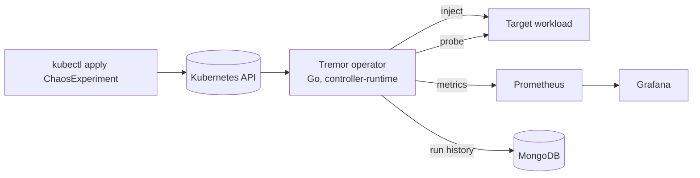

# Tremor

A chaos testing platform for Kubernetes. Declare a failure as a `ChaosExperiment`, let the Go operator inject it into your application, and get a measured **recovery time** back, with Prometheus metrics, a Grafana dashboard and a MongoDB run history.

> Status: **Phase 0 (design and scaffold)**. See [docs/ROADMAP.md](docs/ROADMAP.md).

## What it does

1. You apply a `ChaosExperiment` naming a target workload and a fault.
2. Tremor checks the application is healthy (the *steady state*).
3. It injects the fault (pod kill, network latency or loss, CPU or memory stress, dependency outage, node drain).
4. It watches the application recover and records the time to recovery.
5. Results land in the resource status, in Prometheus, and in MongoDB.



## Stack

Go operator, Kubernetes, Prometheus, Grafana, MongoDB, Docker.

## Develop

Requirements: Go 1.23+, Docker, [kind](https://kind.sigs.k8s.io/), kubectl.

```bash
make test            # unit tests
make build           # builds ./bin/manager
make kind-up         # 3-node local cluster (use kind-up-lite on low memory)
```

## Docs

- [Design](docs/DESIGN.md)
- [Roadmap and phases](docs/ROADMAP.md)
- [Architecture decisions](docs/adr/)
- [API preview examples](examples/)

## License

MIT
