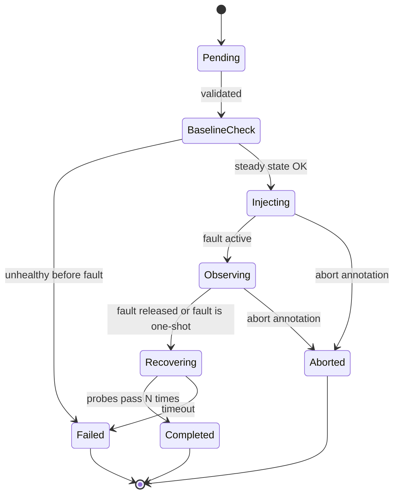

# Tremor design

## Goal

Make resilience testing declarative and measurable. Engineers describe a failure, Tremor injects it safely, and reports how long the application took to recover.

## Components

| Component | Responsibility |
| --- | --- |
| Operator (Go, controller-runtime) | Reconciles `ChaosExperiment` resources through a phase state machine |
| Fault injectors | One implementation per fault type behind a common interface |
| Steady-state prober | HTTP probes against the target; decides "healthy" and "recovered" |
| Metrics | Prometheus endpoint on the operator |
| Dashboards | Grafana dashboard shipped as a ConfigMap |
| Result store | MongoDB collection of finished runs (history, not source of truth) |
| Demo app | Small Go "shop" API backed by MongoDB, used to demonstrate and test |
| `tremorctl` | CLI that reads run history and prints reports (Phase 4) |

## The `ChaosExperiment` API (v1alpha1, group `tremor.dev`)

Sketch of the final shape. `api/v1alpha1` is the source of truth. Implemented through Phase 2: `target`, `fault` (PodKill), `safety`, `steadyState` (HTTP probe) and `recoveryTimeout`. Results are reported in milliseconds as `podRecoveryMillis` and `userRecoveryMillis`.

```yaml
apiVersion: tremor.dev/v1alpha1
kind: ChaosExperiment
metadata:
  name: kill-shop-pod
  namespace: demo
spec:
  target:
    selector: { app: shop }          # pods or deployments, same namespace
  fault:
    type: PodKill                    # PodKill | NetworkLatency | NetworkLoss | CPUStress |
                                     # MemoryStress | DependencyOutage | NodeDrain
    params: { count: 1 }
  duration: 60s                      # how long the fault is held (where applicable)
  steadyState:
    http: { url: http://shop.demo.svc:8080/healthz, expectStatus: 200 }
    interval: 1s
    successThreshold: 3              # consecutive passes needed to count as healthy
  recoveryTimeout: 120s              # give up waiting for recovery
  safety:
    dryRun: false
    maxAffectedPercent: 50
status:
  phase: Completed
  injectedAt: "2026-11-08T10:00:00Z"
  recoveredAt: "2026-11-08T10:00:07Z"
  userRecoveryMillis: 7000           # user-visible, probe based
  userImpacted: true
  podRecoveryMillis: 5200            # all target pods Ready again (Phase 1)
  probeSuccesses: 22                 # availability = 22 / (22 + 3)
  probeFailures: 3
  conditions: []
```

## Experiment state machine



Every fault is reverted on any exit path (finalizer on the resource plus a TTL on injected helpers), so a crashed operator never leaves the cluster broken.

## Recovery time

The headline metric. Defined in [ADR 0003](adr/0003-recovery-time-definition.md): time from fault injection to the first moment the steady-state probe has passed `successThreshold` times in a row, reported alongside the Kubernetes-level pod recovery time.

## Fault mechanisms

| Fault | Mechanism |
| --- | --- |
| PodKill | Delete pods with grace period 0 through the API |
| DependencyOutage | Scale a labelled dependency (for example MongoDB) to zero, restore after `duration` |
| CPUStress / MemoryStress | Ephemeral container running a stress workload in the target pod |
| NetworkLatency / NetworkLoss | Ephemeral container with `NET_ADMIN` running `tc netem` on the pod interface |
| NodeDrain | Cordon plus eviction API, uncordon on release |

Details and safety rules in [ADR 0005](adr/0005-fault-injection-and-safety.md).

## Observability

Prometheus metrics (names fixed now, implemented in Phase 3):

- `tremor_experiments_total{type,result}`
- `tremor_faults_injected_total{type}`
- `tremor_recovery_seconds{type}` histogram
- `tremor_experiment_phase{experiment,phase}` gauge
- `tremor_steady_state_ok{experiment}` gauge

## Data

MongoDB `tremor.runs` documents mirror the finished `status` plus the spec snapshot, cluster name and operator version. The operator keeps working if MongoDB is unreachable (it logs and retries); the resource status is always authoritative for the current run.

## Local development topology

kind cluster (1 control plane, 2 workers) running the operator, the demo app, MongoDB and kube-prometheus-stack. A lite profile with one worker exists for 16 GB laptops, at the cost of limited node-drain testing.

## Out of scope for v1

Multi-cluster experiments, a web UI, cloud-provider faults (EC2 or VM termination), service-mesh fault injection.
